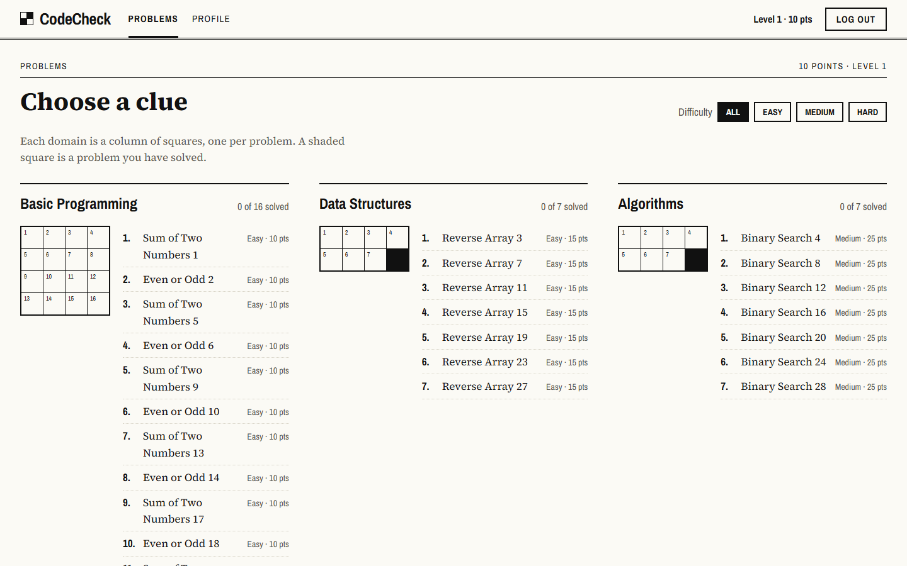
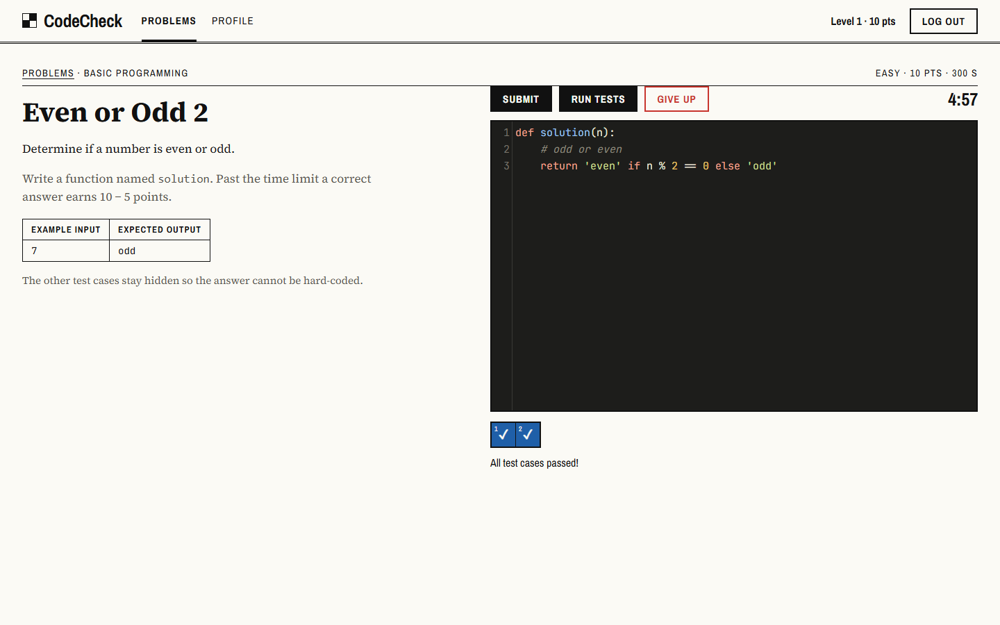
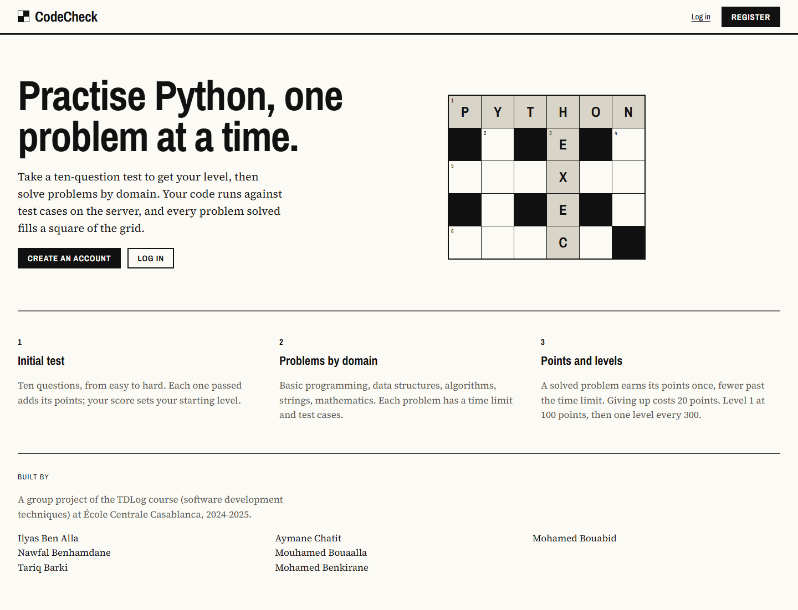

# CodeCheck : s'entraîner à Python, problème par problème

Plateforme web Django pour pratiquer Python. Projet de groupe du cours TDLog (techniques de développement logiciel) à l'École Centrale Casablanca, en 2024-2025, réalisé à sept : Ilyas Ben Alla, Nawfal Benhamdane, Tariq Barki, Aymane Chatit, Mouhamed Bouaalla, Mohamed Benkirane et Mohamed Bouabid. Le dépôt était le mien : les contributions arrivaient par pull request et c'est moi qui les fusionnais.

Mes parties, d'après l'historique : la page d'accueil et la structure des URL, l'inscription, le modèle du test initial, l'exécution du code soumis et le lancement des cas de test, les vues de détail d'un problème et de soumission du test initial, les modèles de domaines et de catégories, le calcul des niveaux, la configuration Docker et la réorganisation finale.

En novembre 2026, j'ai repris le code seul pour corriger des failles, ajouter des tests et une CI et refaire l'interface (détails plus bas).



## Fonctionnement

1. **Test initial.** Un nouveau membre répond à dix questions, de facile à difficile. Chaque question réussie rapporte ses points ; le score fixe le niveau de départ.
2. **Problèmes par domaine.** Programmation de base, structures de données, algorithmes, chaînes de caractères, mathématiques. Chaque problème a un énoncé, une limite de temps et des cas de test, dont un seul est montré.
3. **Correction automatique.** Le code soumis s'exécute côté serveur, cas de test par cas de test, avec un délai de 5 secondes. L'interface affiche une case par cas de test : bleue s'il passe, croix rouge sinon.
4. **Points et niveaux.** Un problème résolu rapporte ses points une seule fois, moins au-delà de la limite de temps. Abandonner coûte 20 points. Niveau 1 à 100 points, puis un niveau tous les 300 points.

| Résolution d'un problème | Accueil |
| --- | --- |
|  |  |

## Lancer le projet

Python 3.12, depuis `TDLog/mysite` :

```bash
python -m venv .venv && source .venv/bin/activate   # Windows : .venv\Scripts\activate
pip install -r requirements.txt
python manage.py migrate && python manage.py create_sample_data
python manage.py runserver
```

Ouvrir http://127.0.0.1:8000 et créer un compte. La base est SQLite par défaut. Avec Docker et PostgreSQL : `docker compose up --build` (variables dans `.env.example`).

## Tests et CI

```bash
python manage.py test
```

17 tests : calcul des niveaux, exécution du code (bonne réponse, mauvaise réponse, erreur de syntaxe, boucle infinie, absence d'accès aux variables d'environnement du serveur), points accordés une seule fois, pénalité de temps, abandon, score du test initial, contrôle d'accès et inscription. GitHub Actions lance ruff, les vérifications Django et les tests à chaque push.

## Corrigé en 2026

- **Score du test initial falsifiable.** Le navigateur envoyait la liste des questions réussies avec leurs points : on pouvait s'attribuer le niveau Expert. Le serveur compte maintenant lui-même les questions qu'il a vu réussir.
- **Points cumulables.** Resoumettre une solution déjà acceptée rapportait les points à chaque fois.
- **Double soumission.** La page d'un problème envoyait chaque soumission deux fois (écouteurs attachés en double).
- **Exécution du code.** Le code tourne avec l'interpréteur courant en mode isolé, dans le dossier temporaire, sans les variables d'environnement du serveur et, sous Linux, avec des limites de CPU, de mémoire et de processus.
- **Configuration.** La clé secrète et les identifiants PostgreSQL étaient dans le code ; la clé a été retirée de tout l'historique, ainsi que la base SQLite, les caches Python et des photos. Un clone neuf ne pouvait pas créer sa base, parce que l'application interrogeait la base dès son démarrage.
- **Interface.** L'ancienne page d'accueil annonçait un support communautaire et des récompenses qui n'existaient pas. La nouvelle interface reprend la grille de mots croisés : chaque domaine est un bloc de cases, une par problème, qui se remplit à mesure des résolutions.

## Limites

- **Ce n'est pas un bac à sable.** Le code soumis s'exécute sur la machine du serveur. Les limites ajoutées réduisent les dégâts possibles, mais un utilisateur malveillant peut encore lire des fichiers ou ouvrir des connexions réseau. Il ne faut pas ouvrir la plateforme au public sans faire tourner le code dans un conteneur isolé ou un service de correction dédié.
- Le temps de résolution est mesuré par le navigateur, qui peut le falsifier.
- Les cas de test cachés sont envoyés à la page (seul l'affichage les masque).
- Les données d'exemple (`create_sample_data`) répètent quelques problèmes simples.
